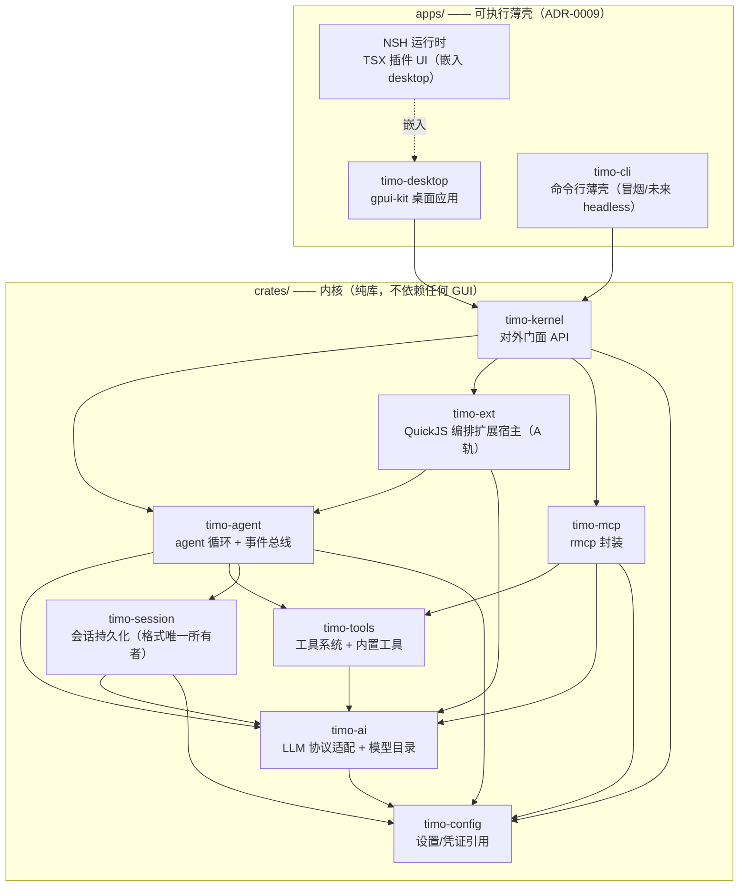

# 架构 01：总体架构

- 状态：定稿
- 日期：2026-10-27（2026-10-26 初稿；2026-10-27 按实现校正依赖图与门面偏差）
- 关联：ADR-0001/0002/0009；architecture/02、03、04

## 1. 分层总览

> **2026-10-27 修订（依赖边按实测 Cargo 清单校正）**：原图 `tools --> ext` 与 `agent --> mcp` 两条边在代码中不存在——`timo-ext` 仅以 **dev-dependency** 依赖 `timo-tools`（供测试），MCP 由门面装配、不经 agent；`ext` 实际位于 agent 与门面之间（硬依赖 `timo-agent`）。同时补齐 `ai → config`、`session → {ai,config}`、`tools → ai`、`mcp → {tools,ai,config}` 等既有边。依据：三路架构一致性审查（`.agents/handoff/H-010-audit-debt.md`）。

## 2. 分层原则（违者否决）

1. **内核不依赖界面**：`crates/` 内禁止出现 gpui-kit/NSH 依赖；界面诉求经事件订阅或薄壳自行状态解决。
2. **门面唯一**：薄壳只 import `timo-kernel` 门面，不穿透到内部 crate。（**2026-10-28 已清偿**：`apps/timo-desktop` 不再直接依赖 `timo-config`；凭证、钥匙串与供应商路径统一经 `timo_kernel::config` 与 `timo_kernel::data_dir()`，见 `docs/roadmap/audit-debt.md` B1。）
3. **事件总线是状态外泄唯一通道**：GUI、CLI 日志、扩展宿主都是订阅者（architecture/02 §3）。
4. **会话格式唯一所有者是 timo-session**：其他模块只见 entry 抽象，不碰磁盘布局。
5. **schema 通货是 JSON Schema**：工具参数、MCP、扩展（TypeBox）三方统一（architecture/03 接缝 #5）。

## 3. 技术栈清单（Phase 1 定稿时可在 standards/04 附录修订）

| 用途 | 选型 | 备注 |
|---|---|---|
| 异步运行时 | tokio | 取消用 CancellationToken 贯穿 |
| HTTP | reqwest | 流式响应 |
| 序列化 | serde / serde_json | |
| Schema | schemars（JSON Schema） | 对应 pi 的 TypeBox 角色 |
| MCP | rmcp 官方 SDK | ADR-0005 |
| JS 引擎 | quickjs-jit（与 NSH 同栈） | ADR-0006 |
| TS 打包 | rolldown + oxc（NSH 工具链复用） | 安装期打包扩展 |
| 桌面 UI | gpui-kit | ADR-0002 |
| 插件 UI/分发 | NSH（TSX/签名包/cap-std） | Phase 4；内核不依赖 |
| 错误处理 | thiserror（库）/ 带上下文错误（壳） | standards/04 |

## 4. 里程碑形态

- **Phase 1 末**：`timo-cli` 可跑通"读文件→改文件→跑命令"的完整 agent 会话，会话落盘可恢复。
- **Phase 2 末**：pi 编排类扩展（选定样本）可装载生效。
- **Phase 3 末**：桌面壳日常可用；NSH 嵌入 PoC 通过。
- **Phase 4 末**：B 轨插件系统闭环（一个自家功能做成插件走完 manifest→签名→授权→渲染全链路）。

详细模块设计见 architecture/02；防返工接缝见 architecture/03。
