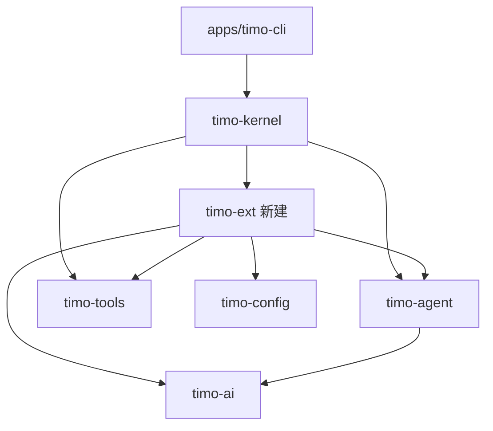
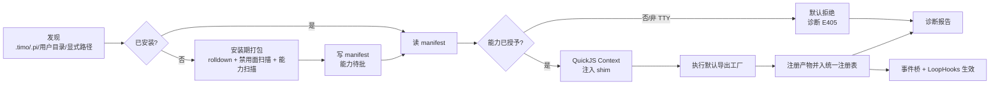

# 设计 00：Phase 2 总览与跨模块决策

- 状态：定稿
- 日期：2026-10-26
- 关联：roadmap/phase-2；architecture/02~04；ADR-0003/0006/0011；本目录 01~05

## 1. 定位与依据

本目录是 Phase 2「编排类扩展宿主（A 轨）」的**实现级详设**：模块边界、接口签名、加载时序、错误分类、权限契约与验收断言。

- 行为唯一蓝本：**pi 1.4.0**（本机 `D:\pi`，只读理解，不复制；AGENTS 铁律 7）。
- 方向约束：ADR-0011（忠实复刻期，创新只记 backlog）。
- 兼容契约：architecture/04 §1 三分类矩阵；矩阵与原版 pi 事件名的**逐项校准**见 05。
- 落地范围：roadmap/phase-2 §2「做/不做」，本目录不扩范围。

## 2. 一句话方案

扩展以 `.ts` 源码形态被发现，**安装期**用 rolldown/oxc 打成单文件 ESM bundle；**运行期**由 timo-ext 在 QuickJS（rquickjs）里执行，注入 pi 兼容 shim；扩展注册的工具/命令并入现有统一注册表，事件钩子经「事件总线（通知）+ LoopHooks（请求-响应）」两条既定通道生效；一切降级、失败、拒绝逐项写入诊断报告。

## 3. 模块布局与依赖方向

### 3.1 新建 crate：`timo-ext`

| 模块 | 职责 | 详设 |
|---|---|---|
| `discovery` | 扫描项目/用户扩展目录，解析入口，确定扩展 id | 00 §5、02 §2 |
| `manifest` | 读写 manifest（能力、来源哈希、状态）；权限数据载体 | 03 |
| `pack` | 安装期打包（feature `pack`）：依赖安装、rolldown、禁用面扫描、能力静态扫描 | 02 |
| `shim` | 虚拟模块 JS 源码（`include_str!`），含 `VERSION` 与惰性 Proxy | 01 |
| `host` | QuickJS Runtime/Context、专用线程、派发队列、工具执行桥 | 04 |
| `hooks` | `LoopHooks` / `ProviderHooks` 的扩展宿主实现 | 04 |
| `permissions` | 能力校验、授予读取、宿主函数闸门 | 03 |
| `diag` | 错误码、逐项诊断、人读/JSON 报告 | 02 §6 |

### 3.2 既有 crate 的增量（只加不改语义）

| crate | 增量 |
|---|---|
| timo-agent | 新增 `LoopHooks` trait 与 `LoopConfig.hooks: Option<Arc<dyn LoopHooks>>`；`run.rs` 在 6 个节点调用（见 04 §2/§3）。默认 `None`，Phase 1 行为逐字节不变 |
| timo-ai | 新增 `ProviderHooks` trait 与 `StreamOptions.provider_hooks`；两协议适配器在请求体/请求头/响应元数据三处调用；无钩子时零行为变化 |
| timo-kernel | 装配扩展宿主；扩展工具先于系统提示构建入表；`set_model` / 命令分发 / 诊断查询成为门面 API |
| timo-cli | `ext` 子命令（`list/add/remove/doctor/trust`）；`--extension` / `--no-extensions` / `--ext-flag`；REPL 斜杠命令分发 |

> 接缝 #2 纪律：`run.rs` 只调用注入 trait 的固定方法，**不出现任何扩展/插件名分支**；默认实现为空操作。该请求-响应通道由 architecture/02 §3 明确授权。

## 4. 装载管线全景

时序要点：

1. 发现失败不阻断启动（同 MCP 惰性策略），只记诊断。
2. 单扩展失败不影响其他扩展与内核；启动期错误经 `KernelEvent::Error` 外显。
3. 扩展工具必须在系统提示构建**之前**入表，否则 `promptSnippet/promptGuidelines` 丢失。
4. 扩展 provider 注册必须先于会话模型解析；未解析到模型的扩展不加载其工具。

## 5. 关键实现决策

| # | 决策 | 理由 / 约束 |
|---|---|---|
| K1 | 引擎 `rquickjs 0.14`，features `full-async`（含 loader/macro/futures） | 成熟高层绑定；支持 ES module、异步、中断处理；与 NSH 的 quickjs-jit 同类 |
| K2 | 单 Runtime + **每扩展一 Context**；全部 JS 跑在一条专用 OS 线程 | Context 隔离扩展全局态；单线程匹配 QuickJS 语义，派发天然串行 |
| K3 | 安装期打包用 `rolldown 1.2` Rust crate + `oxc 0.155` 转换 | 无需 Node 即可打包无依赖扩展；ADR-0006 既定 |
| K4 | npm 依赖仅在扩展声明 dependencies 时才调用 `npm`（registry-only、`--ignore-scripts`、无 git 解析） | 供应链最小面；Node 缺失 → E102 诊断，不静默 |
| K5 | 模块别名双写：`@earendil-works/*` 与 `@mariozechner/*` 指向同一 shim | pi 的旧包名兼容习惯 |
| K6 | `VERSION = "1.4.0"`（**pi API 参考版本**，非本项目版本） | 与真实版本解耦；升级需矩阵评审 |
| K7 | 钩子分两路：通知走事件总线；可改内核态的节点走 `LoopHooks`/`ProviderHooks` | architecture/02 §3 的显式请求-响应授权；避免广播语义承担事务语义 |
| K8 | 权限双闸：manifest 声明 → 用户授予；宿主函数为唯一强制点 | 默认拒绝；QuickJS 无 OS 能力，绕过面为零 |
| K9 | 工具/命令强制 `plugin_<id>_` 前缀 | architecture/04 §3 契约；来源可判别 |
| K10 | 诊断统一错误码 + 逐扩展逐成员条目；同时输出 JSON 与人读表 | B2/B5 的"逐项"要求；可回归断言 |

## 6. 与 pi 的偏离登记（接续 Phase 1 的 D10）

> 类别：a=语言/运行时必然差异；b=既有 ADR 已定载体；c=本仓库规范硬要求。除白名单外一律按 pi。

| # | 偏离 | 类别 | 说明 |
|---|---|---|---|
| D11 | JS 单线程串行执行；并行工具批在 JS 侧串行、宿主 I/O 仍并发 | a | pi 靠 Node 异步事件循环并发；可观察结果一致，吞吐不同 |
| D12 | 无 jiti；安装期打包为单文件 ESM | b（ADR-0006） | 无 `node_modules` 运行时解析 |
| D13 | 扩展工具/命令名加 `plugin_<id>_` 前缀 | c（安全/architecture 04 §3） | 与 pi 裸名不同；钩子载荷同样使用前缀名 |
| D14 | TUI 面成员为惰性 no-op，永不 throw，每扩展每成员一条诊断 | b（ADR-0003） | 与 pi 的 TUI 实现不同 |
| D15 | `VERSION` 为兼容标记 `1.4.0` | a | 不承诺 pi 的 semver（pi 本身无 semver 承诺） |
| D16 | `ctx.ui.select/confirm/input` 映射为 CLI 行文本交互；非 TTY 返回取消 | a（无 TUI） | `notify` 走 stderr |
| D17 | 权限双闸、manifest、默认拒绝 | c（standards/06） | pi 无权限模型 |
| D18 | `AbortSignal` 为最小子集（`aborted`/`addEventListener`/`removeEventListener`） | a | 无 DOM；不实现 `dispatchEvent` |
| D19 | 动态 CLI flag 以 `--ext-flag NAME=VALUE` 承载 | a（CLI 载体） | 静态 clap 无法在解析前得知扩展 flag |
| D20 | provider 钩子作用于本项目两协议的 JSON 载荷；`streamSimple`/OAuth/图像/分类器不支持 | a + backlog | 矩阵内 `registerProvider` 的受限项逐条诊断 |
| D21 | 单 handler 30s 预算（pi 无超时） | c（稳定性/architecture 02 §3） | 超时只切断该 handler，会话继续 |
| D22 | 诊断统一错误码（E1xx~E4xx） | a | pi 只给错误文本与堆栈 |
| D23 | `registerVirtualModel` 最小实现：仅同 provider 内路由；跨 provider 路由诊断拒绝 | a（范围收敛） | 跨 provider 需多凭证解析器，记 backlog |
| D24 | `ctx.executeTool` 与嵌套调用不支持（返回错误 + 诊断） | 范围 | 矩阵未列；codemode 属 backlog |
| D25 | 事件清单按 pi 1.4.0 实际名称校准（architecture/04 的 `error` 不存在；`compact` 实为 `session_*_compact`） | a（文档校准） | 详见 05 §3 |
| D26 | 禁止 `eval` / `new Function`（打包期拒绝） | c（standards/04 §6） | pi 允许动态求值；本项目只允许打包产物执行 |

## 7. 接缝核对（architecture/03）

| 接缝 | Phase 2 落点 |
|---|---|
| #2 事件总线 | 通知事件只从 `KernelEvent` 派生；可改态节点走 `LoopHooks`；循环内无扩展分支 |
| #4 工具元模型 | 扩展工具复用 `ToolDefinition`（exposure/namespace/annotations/execution_mode 全字段），注册表来源不可区分 |
| #5 JSON Schema | TypeBox 对象按普通 JSON 序列化后即 JSON Schema；校验仍只走 `jsonschema` 一条路 |
| #6 富流事件 | `message_update` 由 `AssistantStreamEvent` 映射，不新增裸字符串流 |
| #7 取消贯穿 | run 的 `CancellationToken` → 扩展工具、`pi.exec`、fetch、hook 退休；工具取消可中断 JS |

## 8. 提交序列（本阶段）

1. **本批**：Phase 2 详设定稿（本目录 6 篇）+ 阶段文档/看板/CHANGELOG 登记。
2. timo-ext 骨架 + discovery/manifest/diag（先能装载空扩展并出报告）。
3. pack：rolldown 打包 + 禁用面扫描 + E1xx 表；夹具。
4. shim + host：模块别名、`VERSION`、惰性 Proxy、工具/命令注册；hello 样本跑通。
5. 事件与钩子：事件桥、`LoopHooks`、`ProviderHooks`、30s 预算、abort 退休。
6. 权限：manifest 校验、宿主闸门、授予流程、E4xx；B4/B5。
7. CLI：`ext` 子命令、斜杠命令、`--extension`；诊断报告呈现。
8. 验收 B1~B6 → `report.md` → 看板/CHANGELOG → tag `phase-2.end`。

## 9. 验收样本选定（B1）

| 样本 | API 面 | 结论 |
|---|---|---|
| `hello.ts` | `registerTool` + TypeBox | **选**（最小闭环） |
| `permission-gate.ts` | `tool_call` 否决 + `ui.select` + `hasUI` | **选**（钩子否决与对话框映射） |
| `protected-paths.ts` | `tool_call` 否决 + `ui.notify` | **选**（纯否决路径） |
| `todo.ts` | `sessionManager.getBranch` + `ui.custom` | 不选：依赖缓做成员，无法"真实生效" |
| `auto-commit-on-exit.ts` | `sessionManager.getEntries` + `pi.exec` | 不选：同上；`exec` 另由自写夹具覆盖 |

- 3 个样本满足 B1 的「3~5 个」下限；覆盖工具注册、钩子否决、对话框、通知四类面。
- 样本**不入库**（pi 上游 MIT 但铁律 7 禁止复制），人工验收直接指向本机 pi 检出目录；仓内夹具一律自写（02 §7）。

## 10. 风险与待决问题

- **rquickjs 中断语义**：30s 超时必须证明"切断后同一 Context 仍可执行下一条脚本"；若实测不可恢复，退化为整 Context 重建并记诊断（不影响会话）。
- **rolldown Rust API 稳定性**：1.2.x 处于快速迭代；版本锁定，升级按 standards/08 §5 窗口化。
- **Windows 路径/编码**：manifest 与诊断文件统一 UTF-8；路径比较按规范化小写（03 §6）。
- **待决**：`registerVirtualModel` 跨 provider 是否在 Phase 2 内补齐（当前 D23 收敛）；`messages` 类事件是否进入 architecture/04 的正式矩阵（当前 05 已按 pi 全量列出，建议下轮修订 architecture/04）。
