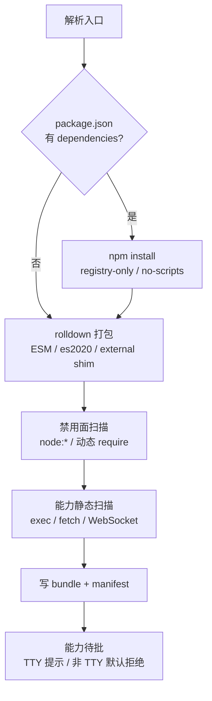

# 设计 02：安装期打包管线、错误分类与诊断报告

- 状态：定稿
- 日期：2026-10-26
- 关联：ADR-0006；architecture/04 §2；roadmap/phase-2；本目录 00/01/03/04

## 1. 边界与时机

| 阶段 | 做什么 | 不做什么 |
|---|---|---|
| **安装期**（`timo ext add`，一次性） | 复制源码、安装 npm 依赖（仅声明时）、rolldown 打包、禁用面扫描、能力静态扫描、写 manifest | 执行扩展代码 |
| **加载期**（每次启动） | 读 manifest、校验来源哈希、权限闸门、创建 QuickJS Context、导入 bundle、执行工厂 | 重新打包、解析 npm |
| **运行期** | 派发事件、执行工具、执行 `pi.exec`/fetch | 文件系统访问（扩展无直接能力） |

- 运行期**不需要 Node**；打包器是 Rust 依赖（rolldown/oxc）。
- Node/npm 只在"扩展声明了 npm dependencies"时需要；缺失即诊断 E102，不静默降级。
- 加载期禁止联网；除读取扩展目录外无 IO 副作用。

## 2. 存储布局

```
<agent_dir>/extensions/
└── <id>/
    ├── source/            # 源码副本（只读；含 package.json 时一并复制）
    ├── bundle.mjs         # 单文件 ESM 产物
    ├── manifest.json      # 声明与来源指纹（见 §2.1）
    └── diagnostics.json   # 最近一次加载的逐项诊断（覆盖式）
```

- 显式路径（`--extension <path>`）不写入长期目录：按 `sha256` 前 12 位缓存在 `<agent_dir>/cache/ext/<hash>/`，内容变更即换目录。
- 单扩展目录总大小上限 20 MiB、bundle 上限 5 MiB；超限 E108。
- 授权（grants）**不写 manifest**，单独存 `<agent_dir>/permissions.json`，按 `id + sourceHash` 绑定；源码/产物变化即失效（E406）。

### 2.1 manifest.json

```json
{
  "schema": 1,
  "id": "todo",
  "entry": "source/index.ts",
  "bundle": "bundle.mjs",
  "sourceHash": "sha256:…",
  "bundler": "rolldown-1.2.15+oxc-0.155.0",
  "createdAt": "2026-10-26T12:00:00Z",
  "capabilities": {
    "exec": true,
    "net": { "domains": ["api.example.com"] },
    "fs": { "read": ["./docs/**"], "write": [], "delete": [] }
  }
}
```

- `capabilities` 是**声明**（扩展需要什么），不是授权；字段语义见 03。
- `sourceHash` 对 `source/` 全量文件按路径排序后的内容哈希，用于授权失效与诊断复现。
- 未知字段保留不报错（向后兼容）；`schema` 大于本版 → E205。

## 3. 打包流程



1. **入口解析**（对齐 pi loader 语义）：
   - `package.json` 的 `pi.extensions` 数组（取第一个有效项）；
   - 否则 `index.ts` / `index.js`；
   - 否则目录同名 `.ts` / `.js`；
   - 都不满足 → E101。
2. **依赖安装**：仅当 `dependencies` 非空。规则：只允许 registry 版本（拒绝 `git:`/`file:`/`link:`/workspace:` 与 lifecycle scripts）；`npm install --ignore-scripts --no-audit --no-fund --no-package-lock`；临时目录在系统 temp，完成后只保留 `node_modules` 供打包，打包后删除。
3. **打包**：rolldown `input=entry`、`format=esm`、`platform=neutral`、`target=es2020`、`treeshake=true`、**不 minify**（诊断可读）、不生成 sourcemap；`external` = 01 §1 的 shim specifier 列表。
4. **禁用面扫描**：对**打包产物**再扫一遍（防止依赖内联带入）：`node:*`、Node 裸内建、`require(`、`import(` 非字面量、`process.` 顶层引用 → E104/E105。
5. **能力静态扫描**：命中 `pi.exec(`、`fetch(`、`new WebSocket(`、`XMLHttpRequest`、`pi.registerProvider(` 等，生成建议能力清单（**建议值，不是事实**；运行期仍以 manifest 声明 + 用户授予为准）。
6. **写盘**：先写临时目录，全部成功后原子 rename；失败不留半成品。

## 4. 转换与兼容规则

| 规则 | 说明 |
|---|---|
| TS 语法 | oxc 转换，`target=es2020`；QuickJS 不支持的语法（装饰器、`using` 等）→ E106 |
| 模块 | 只支持 ESM 产物；CJS 入口由 rolldown 转换；`require()` 在产物中不允许 |
| 顶层 await | 允许（ESM），但工厂执行前会先完成模块求值；超过工厂预算 → E202 |
| `export default` | 必须是函数（同步/异步均可）；缺失或非函数 → E202 |
| 动态导入 | 仅接受字符串字面量且指向已打包模块；否则 E105 |
| `eval` / `new Function` | 允许（QuickJS 沙箱内），但不享受任何宿主能力；静态扫描不阻断 |
| 全局 `__dirname`/`__filename` | 不提供；引用即运行期 ReferenceError（E202/E303） |

## 5. 错误分类总表

> 错误码唯一出处即本表；诊断、CLI、测试断言一律引用错误码。`phase` 取值：`discover/pack/load/runtime/permission`。

### 5.1 打包（E1xx）

| 码 | 触发 | 处置 | 阻断装载 |
|---|---|---|---|
| E101 | 入口无法确定 | 提示期望的目录结构 | 是 |
| E102 | npm 依赖安装失败（无 Node/registry 不可达/版本不存在） | 打印 npm stderr 尾部 + 解决建议 | 是 |
| E103 | 模块解析失败（依赖缺失、未知 specifier） | 指出缺失模块与引用方 | 是 |
| E104 | 引用 `node:*` 或 Node 裸内建 | 列出模块与调用点 | 是 |
| E105 | 非法依赖源或非字面量动态导入 | 指出语句位置 | 是 |
| E106 | 语法超出目标（oxc 报错） | 打印行列与片段 | 是 |
| E107 | 打包器内部错误 | 打印错误链；建议锁版本复现 | 是 |
| E108 | 产物/目录超限（5 MiB / 20 MiB） | 提示拆分或删依赖 | 是 |
| E109 | manifest 与产物哈希不一致 | 要求重新安装 | 是 |
| E110 | manifest schema 非法/版本过高 | 指出字段 | 是 |

### 5.2 加载（E2xx）

| 码 | 触发 | 处置 | 阻断该扩展 |
|---|---|---|---|
| E201 | 扩展显式版本检查失败 | 原样展示扩展抛出的文案 | 是 |
| E202 | 模块求值/工厂抛错、工厂超时 | 展示异常与栈（截断） | 是 |
| E203 | shim 缺失导出（扩展导入不存在的成员） | 指出成员名 | 是 |
| E204 | id/工具/命令/flag 冲突 | 展示冲突项与胜出方 | 是（冲突项跳过） |
| E205 | manifest 缺失/损坏 | 自动生成默认拒绝 manifest 或拒绝装载 | 视情况 |
| E206 | 扩展目录不可读 | 展示路径与系统错误 | 是 |

### 5.3 运行期（E3xx）

| 码 | 触发 | 处置 | 影响面 |
|---|---|---|---|
| E301 | 钩子超 30s 预算 | 中断该 handler，记诊断，会话继续 | 该次调用 |
| E302 | 钩子抛错/返回非法结构 | 丢弃该 handler 结果 | 该次调用 |
| E303 | 工具抛错/返回非法结果 | 转错误工具结果 | 该次调用 |
| E304 | 载荷/内容块类型非法 | 丢弃非法字段并诊断 | 该次调用 |
| E305 | 宿主通道关闭/扩展已卸载 | 丢弃调用 | 该次调用 |
| E306 | 定时器超过 256 个待触发 | 丢弃新定时器 | 该定时器 |

### 5.4 权限（E4xx）

> 详细规则见 03。

| 码 | 触发 |
|---|---|
| E401 | 能力未声明（执行/网络/文件） |
| E402 | 域名不在白名单 |
| E403 | 作用域非法（写/删全树） |
| E404 | 硬拒路径（`.env*`、SSH 凭证、`.git/**`） |
| E405 | 用户拒绝授权或非 TTY 无授予 |
| E406 | 授权随源码变化失效 |

## 6. 诊断报告

### 6.1 数据结构（`diagnostics.json`）

```json
{
  "generatedAt": "2026-10-26T12:00:00Z",
  "kernel": "0.1.14",
  "extensions": [{
    "id": "permission-gate",
    "path": "…/extensions/permission-gate",
    "status": "loaded",
    "sourceHash": "sha256:…",
    "registered": { "tools": ["plugin_permission_gate_…"], "commands": [], "hooks": ["tool_call"] },
    "degraded": [{ "member": "ctx.ui.setWidget", "class": "tui", "code": "E302" }],
    "errors": []
  }],
  "summary": { "loaded": 1, "degraded": 0, "failed": 0 }
}
```

- `status`：`loaded`（全部生效）/`degraded`（有降级但可用）/`failed`（未装载）。
- `degraded` 按"扩展 × 成员"去重；`errors` 按发生次序保留（同一码同一调用点去重）。
- 聚合文件：`<agent_dir>/extension-diagnostics.json`（覆盖式，非流水）。

### 6.2 人读输出

- 启动时只打印 `failed` 与 `degraded > 0` 的摘要行（stderr），不刷屏。
- `timo ext doctor` 打印逐扩展表：

```
ID              STATUS    TOOLS  HOOKS  DEGRADED  ERRORS
permission-gate loaded    0     1      0         -
pure-tui        degraded  0     0      6         -
node-fs         failed    0     0      0         E104 node:fs (source/index.ts:3)
```

- 每条错误必须包含：**码 + 人话原因 + 定位 + 下一步**；禁止只给栈。

## 7. 测试、夹具与验收映射

### 7.1 自写夹具（不入库任何 pi 源码）

| 夹具 | 覆盖 |
|---|---|
| `hello_like.ts` | registerTool + TypeBox + 执行结果 |
| `veto_like.ts` | `tool_call` 否决 + `ctx.hasUI` |
| `notify_like.ts` | `ui.notify` + `agent_end` |
| `tui_like.ts` | `ui.setWidget/custom` + 渲染注册（B2 的自家等价物） |
| `node_fs_like.ts` | `node:fs` 引用（B5） |
| `timeout_like.ts` | 钩子死循环（B3 超时） |
| `mutate_like.ts` | 钩子改 payload 但不走返回通道（B3 detach） |
| `exec_like.ts` | `pi.exec` + 权限拒绝/授予（B4） |
| `net_like.ts` | 未声明 fetch（B4） |
| `manifest_wide_fs.ts` | 全树写声明（B4 拒绝） |

- 夹具走 `fixtures/extensions/`，由集成测试在临时 agent_dir 中安装，不污染开发者目录。
- 真实样本（B1/B2 人工验收）直接指向本机 pi 检出：`D:\pi\packages\coding-agent\examples\extensions\`，**不复制进仓库**。

### 7.2 验收映射

| 场景 | 本设计落点 |
|---|---|
| B2 不崩 + 逐项 no-op | §6 诊断结构 + `degraded` 计数；tui_like 快照 |
| B4 未声明网络被拒、全树 fs 被拒 | E401/E402/E403 + 03 §6/§7 |
| B5 `node:fs` 装载失败透明 | E104 + §6.2 错误行 |
| B6 接缝 + CI | §7 夹具进 CI；`cargo test` + `check-size` |

## 8. 待决问题

- **rolldown Rust API 的稳定面**：若 `Bundler` 配置项在 1.2.x 内变动，锁定次版本并提供适配层；不把 rolldown 类型泄漏出 `pack` 模块。
- **npm 缺失时的体验**：E102 已定；是否提供"仅打包无依赖扩展"的离线提示，等实测用户体验后定。
- **bundle 上限 5 MiB**：暂定值；若官方样本（如 with-deps）触发，按实测调整并登记。
- **能力静态扫描的误报**：只作为建议清单，不做拒绝依据；扫描规则表随夹具演进。
