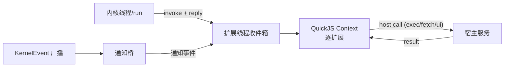

# 设计 04：钩子语义 —— 派发、预算、快照隔离、abort 退休

- 状态：定稿
- 日期：2026-10-26
- 关联：architecture/02 §3、03 #2/#7；standards/04 §3、05 §3；本目录 01/05
- 蓝本：pi 1.4.0 `extensions/runner.ts`（顺序派发、逐 handler 隔离、覆盖/短路规则）

## 1. 派发模型



- **一条专用 OS 线程**承载 QuickJS Runtime；所有 Context 在该线程执行。
- **单次在飞**：同一时刻只有一个"内核发起的调用"（钩子/工具/命令/工厂）在 JS 侧执行；其余排队。通知事件可排队但不阻塞请求-响应。
- **宿主调用不与内核回调互等**：`exec/fetch/ui` 由宿主服务（内核侧）执行，扩展线程等待其结果；宿主服务**不得**在该等待期间回调 JS，避免自锁。
- 通知桥使用有界队列（1024）；溢出丢弃最旧的通知并计数（E305 仅记录一次），请求-响应调用不丢弃。
- JS 侧均为逐扩展的 Context；扩展间不共享全局态，`pi.events` 为宿主提供的显式共享通道。

## 2. 请求-响应接口（Rust）

### 2.1 `timo-agent::LoopHooks`

```rust
#[async_trait]
pub trait LoopHooks: Send + Sync {
    /// run 开始前（AgentStarted 之前）；返回替换后的系统提示。
    async fn before_agent_start(&self, req: BeforeAgentStart<'_>) -> Option<String> { None }

    /// 每次模型请求前（不含 system）；返回替换后的消息列表。
    async fn transform_context(&self, messages: Vec<Message>) -> Option<Vec<Message>> { None }

    /// context 之后、含 system 的完整 transcript；返回即最终使用值。
    async fn transform_full_context(
        &self,
        system_prompt: Option<String>,
        messages: Vec<Message>,
    ) -> Option<(Option<String>, Vec<Message>)> { None }

    /// 虚拟模型路由（D23）；None = 沿用会话模型。
    async fn route_model(&self, req: RouteRequest<'_>) -> Option<RouteChoice> { None }

    /// 工具参数校验前；可否决/改参/提前终止。
    async fn before_tool_call(&self, call: &Content) -> Option<BeforeToolCall> { None }

    /// 工具执行后、结果入上下文前；字段级覆盖。
    async fn after_tool_call(&self, outcome: &ToolOutcome) -> Option<ToolOutputPatch> { None }

    /// 当前生效系统提示（ctx.getSystemPrompt）。
    fn system_prompt(&self) -> Option<String> { None }
}
```

- 所有方法都有默认空实现，Phase 1 的 `LoopConfig` 只需新增 `hooks: Option<Arc<dyn LoopHooks>>`；`None` 时逐字节等价现状。
- `BeforeToolCall { block: Option<String>, args: Option<Value>, terminate: bool }`；`ToolOutputPatch` 字段与 `ToolOutput` 同名、逐字段 Option。
- 扩展宿主是唯一实现者；内核不知道"扩展"存在（接缝 #2）。

### 2.2 `timo-ai::ProviderHooks`

```rust
#[async_trait]
pub trait ProviderHooks: Send + Sync {
    /// 请求体 JSON 构建后、发送前；返回替换体。
    async fn before_request(&self, payload: Value) -> Option<Value> { None }
    /// 请求头组装后；返回替换头表（值为 None 表示删除）。
    async fn before_headers(&self, headers: Vec<(String, String)>) -> Option<Vec<(String, Option<String>)>> { None }
    /// 收到成功响应、消费流前（只通知）。
    async fn after_response(&self, status: u16, headers: Vec<(String, String)>);
}
```

- `StreamOptions` 新增 `provider_hooks: Option<Arc<dyn ProviderHooks>>`；两个适配器在 `build_body` 后、`post_sse` 前调用；传输层在拿到成功响应头后调用 `after_response`。
- 无钩子时零行为变化（Phase 1 回放测试不受影响）。

## 3. 时序与内核落点

| 节点 | 位置 | 顺序 |
|---|---|---|
| `before_agent_start` | `run_agent_loop` 首行之前 | 钩子 → 替换系统提示 → `AgentStarted` |
| `route_model` | `Ctx::request_once` 构建 `Context` 前 | 选模型 → 组装 Context → 请求 |
| `transform_context` | `request_once` 组装 `Context` 前 | 作用于 `ctx.messages`（无 system） |
| `transform_full_context` | `transform_context` 结果之后 | 含 system；返回即用 |
| `before_provider_request/headers` | timo-ai 适配器 | 体 → 头 → 发送 |
| `after_provider_response` | 传输层 | 响应头到达 → 流消费前 |
| `before_tool_call` | `Ctx::run_one` 参数校验前 | 钩子 → 否决/改参 → 校验 → Started |
| `after_tool_call` | `run_one` 执行后、构造结果消息前 | 结果 → 覆盖 → Finished |

- **被否决的调用**：不执行工具；生成 `is_error=true` 的工具结果（reason 为文案）；仍发射 `ToolCallStarted/Finished`，保证 CLI 可见。
- **改参**：写回 `Content::ToolCall.arguments`，随后走既有 JSON Schema 校验（pi 是"改后不重新校验"，本项目按接缝 #5 统一校验；差异记录为安全加固，见 §9）。
- `terminate` 合并规则沿用内核：本批全部 terminate 才早停。

## 4. 顺序、覆盖与恢复

| 规则 | 实现 |
|---|---|
| 派发顺序 | 扩展按装载顺序；扩展内按 `on()` 注册顺序；逐个 await |
| `systemPrompt` | 后者覆盖前者；最后一个非 `undefined` 生效 |
| `context` | 每个 handler 收到**当前最新**消息副本；可返回 `{messages}` 或原地改；system 由内核恢复 |
| `context_with_system` | 收到完整 transcript；返回即最终值；后续 handler 看到该结果 |
| `tool_call` | 同一事件对象在 handler 间传递（后者可见前者改参）；首个 `block=true` 立即短路 |
| `tool_result` | 字段级覆盖累积；替换 `content` 且未给 `structuredContent` → 后者丢弃 |
| `provider headers` | 返回 `None` 的键删除；未返回则沿用 |
| 非法返回值 | 记 E302，忽略该 handler 结果，继续下一个 |

## 5. 30s 预算

- **口径**：每个 handler 从开始到 settle 的**计算预算** 30s。以下等待**不计入**：
  - `ctx.ui.select/confirm/input` 的用户交互时间（对话框自身没有超时则一直等）；
  - `pi.exec` 子进程运行时间与 `fetch` 网络等待（它们各自受取消/超时约束）。
- **目的**：切断死循环/失控计算，而不是限制合法长任务。
- **机制**：
  1. 扩展线程为每次 handler 设置 deadline；QuickJS 中断处理器在 deadline 到期后返回 true；
  2. 宿主侧定时器在 deadline 触发时置中断标志（线程安全）；
  3. handler 被中断 → 丢弃其结果，记 E301，继续下一个 handler；会话不受影响。
- **可恢复性**：必须证明"被中断后同一 Context 仍能执行下一条脚本"（B3 断言）。若 rquickjs 实测不可恢复：重建该扩展 Context 并标记 `degraded`（工具/命令注销，钩子停用），记 E301 附"context rebuilt"；会话继续。
- **测试注入**：预算与时钟可注入（standards/05 §3）；CI 用 100~300ms 预算，生产 30s。
- **工具执行**不适用本预算（见 01 §6）；只受取消令牌约束。

## 6. 快照隔离（detach）

1. 内核 → JS：每个事件载荷经 `serde_json` 序列化为**新 JS 对象**；JS 侧改动不回写内核，除非命中白名单。
2. 同一事件的一次派发内，多个 handler 共享该 JS 事件对象（保证 pi 的"后者看到前者改动"语义）。
3. 回读白名单（且仅此列表）：

| 通道 | 回读字段 |
|---|---|
| `tool_call` | `event.input`（改参）、返回 `{block, reason, terminate}` |
| `tool_result` | 返回 `{content, details, structuredContent, isError, usage}` |
| `context` | 返回 `{messages}` 或 `event.messages` |
| `context_with_system` | 返回 `{messages}` |
| `before_agent_start` | 返回 `{systemPrompt}` |
| `before_provider_request` | 返回值（替换请求体） |
| `before_provider_headers` | `event.headers` 或返回头表 |
| `registerVirtualModel.route` | 返回 `{model, thinkingLevel?}` |

4. 白名单外的一切改动（如 handler 改 `event.message`、`event.toolResults`）**不产生任何效果**，也不报错（pi 对不可改事件本身也忽略返回值）。
5. 大载荷（图像、长消息）按值复制；单事件序列化上限 8 MiB，超限 → E304，事件不派发。

## 7. abort 退休

- 每次 run 分配 `epoch: u64`；派发时携带 epoch。
- run 取消（用户 abort/第二段 Ctrl+C/内核错误终止）时：
  1. 置 `ctx.signal.aborted = true`；
  2. 中断当前 JS 执行；
  3. 该 epoch 的**待派发与在飞**结果全部丢弃；
  4. 通知桥丢弃该 epoch 的排队事件。
- 下一次 run 使用新 epoch，订阅关系不变，handler 自动恢复。
- B3 断言：abort 后标记 handler 的调用计数不再增长；在飞 handler 能观察到 `signal.aborted === true`。

## 8. 错误隔离

- 单 handler 抛错/拒绝/返回非法结构 → E302，继续下一个 handler；内核状态不变。
- 工厂执行错误 → 该扩展 `failed`，其他扩展与内核不受影响（E202）。
- 工具执行错误 → 错误工具结果（E303），不抛到循环。
- 宿主服务错误（通道关闭/扩展卸载）→ E305，丢弃该次调用。
- 任何情况下**不 panic、不 unwrap**（standards/04）；扩展错误绝不进入内核 `Result`。

## 9. 重入与注册

- handler 内允许调用动作面（`exec`、`ui.*`、`setActiveTools`、`setModel`、`sendUserMessage`）；宿主以异步服务执行，不递归进入 JS。
- handler 内 `registerTool/registerCommand/on(...)`：允许；对**后续**请求/事件生效；不回溯当前批次。
- 禁止：在 handler 内同步等待另一个钩子完成（无此 API）；`ctx.executeTool` 未开放（D24）。
- `sendUserMessage` 空闲启动：只入队并置标志；由门面在 run 结束后启动，避免在扩展线程内重入 `run`。

## 10. B3 验收断言

| 断言 | 夹具 | 判定 |
|---|---|---|
| 超时切断、会话继续 | `timeout_like`（死循环钩子） | 在预算 +1s 内返回；随后一次普通 prompt 成功；诊断含 E301 |
| 超时后 Context 可复用（或明确重建） | `timeout_like` + 次条脚本 | 同一扩展的下一事件正常执行；若走重建路径，诊断注明 |
| payload 改动不外泄 | `mutate_like` | handler 改 `event.message`/`event.toolResults`/`event.systemPrompt` 后返回 undefined：内核消息数、内容、系统提示均不变 |
| 白名单改动生效 | `veto_like` 改参 | 工具实际收到改后参数（记录到夹具输出） |
| abort 退休 | `abort_like` | abort 后 handler 计数不增；在飞 handler 读到 `signal.aborted` |
| 错误隔离 | `throw_like` | 抛错 handler 后续 handler 仍执行；会话完成 |

## 11. 待决问题

- **改参后重新校验**：本项目比 pi 更严（pi 不重新校验）。这是 standards/06 的安全要求，记为"受限差异"；若真实样本依赖"改参绕过原 schema"，再评估。
- **中断线程安全**：`Runtime::interrupt()` 的跨线程语义需在实现首日做探针验证；不成立则改为扩展线程自驱动 deadline。
- **通知积压**：1024 上限与丢弃策略需在 B1 长会话实测后定。
- **ui 等待与预算的边界**：对话框取消（用户 Ctrl+C）与 run abort 的关系需在 CLI 实现时统一（当前：对话框取消只让 handler 收到取消值，不 abort run）。
