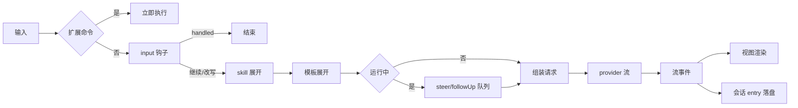
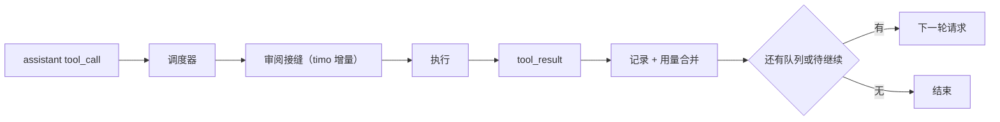
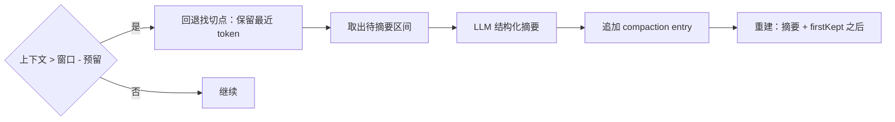

# 调研 06：pi 交互逻辑、数据流向与提示词工程调查

- 状态：**定稿**（2026-10-27，Phase 3.5 R1 产出）
- 调查对象：本地 pi 源码（只读），package 版本 1.4.0，HEAD `d5b3de22d`（v1.4.0-67）；未复制代码或文案（铁律 7）。
- 关联：ADR-0011/0013；roadmap/phase-3.5 §3-R1；research/01（代码分层）、research/02（扩展机制）

## 1. 结论速览

1. 系统提示是**分节结构**，不是一段字符串：`preamble` 为裸文本，其余各节用同名 XML 标签包裹；按节做差异更新，扩展可只改一节。
2. 项目上下文 = agent 目录的全局上下文文件 + 从 cwd 向上每层祖先目录各取一个候选文件，**根在前、cwd 最后**；不因项目信任被跳过。
3. skills 在提示里只占"名字 + 描述 + 路径"三项，正文按需读取；`/skill:name` 可强制注入；标记了 `disable-model-invocation` 的技能不进提示。
4. 输入处理顺序固定：扩展命令 → input 钩子 → skill 展开 → 模板展开 → 入队或开跑；**流式中必须显式声明 steer 或 followUp**，缺失即报错。
5. 用量按 `provider/model` 分桶；工具与摘要的用量单列一桶；嵌套工具调用的用量并入父调用的工具结果。
6. 压缩阈值 = 上下文 > 窗口 − 预留（默认 16384），保留最近 20000 token；摘要作为新 entry 追加，原始 entry 永不删除。

## 2. 提示词工程合同（P0 详设的直接输入）

证据：`core/system-prompt.ts:128-229`、`core/resource-loader.ts:211-301`、`core/skills.ts:358-397`。

### 2.1 组装管道（顺序即合同）

| 序 | 节名 | 内容 | 条件/来源 |
|---:|---|---|---|
| 1 | `preamble`（无标签） | 自定义提示词整段（此时**不生成** `tools`/`rules`/`docs` 三节），或默认身份行 | 有自定义提示词时整段替换 |
| 2 | `tools` | 每个**有单行摘要**且未被隐藏的已选工具一行；空则 `(none)`；末尾固定一句"可能还有其它自定义工具" | 仅默认提示时生成 |
| 3 | `rules` | 去重合并：bash/powershell 兜底规则（仅当未选 grep/find/ls）、每个已选工具的指南、全局追加指南、固定两条（回复简洁、写文件时给出路径） | 仅默认提示时生成 |
| 4 | `docs` | 文档根路径（主文档、附加文档、示例）+ 主题索引（扩展、主题、技能、模板、TUI、快捷键、SDK、供应商、模型、包、环境变量、MCP、codemode） | 仅默认提示时生成；路径按安装位置 |
| 5 | `addendum` | 用户追加的系统提示（配置文件或 `APPEND_SYSTEM.md`） | 非空时 |
| 6 | `project_context` | 引导句 + 每文件一个 `<project_instructions path="…">` 块 | 上下文文件非空时 |
| 7 | `skills` | 说明三句 + `<available_skills>`（name/description/location） | 存在可读工具且技能非空 |
| 8 | `cwd` | 工作目录（反斜杠转正斜杠） | 始终 |
| 9 | 自定义节 | 扩展注册的任意节 | 名字须匹配 `^[a-z][a-z0-9_-]*$`，不得叫 `preamble`，空内容跳过 |

- 除 `preamble` 外，每节输出为 `<节名>\n内容\n</节名>`，节名即标签名；模型可据此匹配后续更新。
- `forceSystemPrompt` 是**整段替换**（不透明、无节），来自 `before_agent_start` 钩子；与分节路径互斥。
- 会话内提示变化时按节做补丁（新增/替换/null 删除），避免整段重发。

### 2.2 工具 loadout

| 概念 | 语义 |
|---|---|
| 已选工具 | 默认 read/bash/edit/write；决定哪些工具进入提示与规则 |
| 隐藏工具 | 仍可被其它工具调用，但**不出现在**提示的工具清单、技能提示与规则里 |
| 单行摘要 | 每工具一句话，进入 `tools` 节；无摘要的工具不展示 |
| 工具指南 | 每工具若干条规则，按已选顺序合并进 `rules` |
| 全局追加指南 | 扩展可追加规则条目 |

### 2.3 项目上下文文件

- 候选名（每目录取第一个存在的普通文件）：`AGENTS.override.md` → `AGENTS.md` → `AGENTS.MD` → `CLAUDE.md` → `CLAUDE.MD`。
- 全局：agent 目录下的同名候选，排第一。
- 祖先：从文件系统根到 cwd，逐层收集后反转成"根在前、cwd 最后"；去重。
- 读取时去 BOM；链接工作树与主仓同逻辑仓时只保留一份（避免重复注入）。
- 上下文文件**不受项目信任门控**：它属于输入内容，不属于可执行资源。

### 2.4 skills 的加载与注入

- 来源：用户目录 `skills/`、项目 `.pi/skills/`、Agent Skills 位置（`~/.agents/skills/` 与 `.agents/skills/`，项目侧从 cwd 向上到仓库根）、显式路径。
- 发现规则：目录含 `SKILL.md` 即视为技能根、不再下钻；根目录的直接 `.md` 也算技能；子目录继续递归找 `SKILL.md`；跳过点目录与 `node_modules`；尊重 `.gitignore`/`.ignore`/`.fdignore`（按目录加前缀，支持取反）。
- 校验：名字 ≤64、仅小写字母/数字/连字符、首尾无连字符、无连续连字符；描述必填且 ≤1024；违规只告警不中止；缺名字时取父目录名；同名冲突**先发现者胜出**并告警。
- 注入：只放名字、描述、路径；正文由模型在匹配时读取，`/skill:name` 强制注入（去 frontmatter 的正文 + 相对路径基准 + 追加参数）。

### 2.5 扩展点与时序

- `before_agent_start`：改系统提示（Phase 1 已实现替换语义）。
- `input`：可处理（拦截）或改写输入；早于 skill 与模板展开。
- `session_before_compact` / `session_compact_failed` / `session_before_tree`：压缩与分支跳转的前置/失败钩子。
- 模板展开发生在 input 钩子之后、入队之前；扩展命令在一切之前直接执行。

## 3. 交互语义清单（pi 行为 → timo 对应面）

| # | pi 行为 | timo 现状 | 归属 |
|---:|---|---|---|
| 1 | 运行中 `Enter` 发送 = steer：当前回复与工具批结束后、下次请求前注入 | 内核队列已对齐（`PendingMessageQueue`，默认一次一条） | 已覆盖（内核） |
| 2 | 运行中 `Alt+Enter` = followUp：整个任务结束后才投递 | 内核队列已对齐 | 已覆盖（内核） |
| 3 | `Alt+Up` 把排队消息退回编辑器 | 无 | 桌面壳改进 |
| 4 | `Esc` 中止当前任务，排队消息退回编辑器 | 取消已有；退回未做 | 桌面壳改进 |
| 5 | 工具过程逐条展示，`Ctrl+O` 展开/折叠 | 工具卡片已有（状态/参数/结果/耗时） | 已有；单卡折叠待补 |
| 6 | `Ctrl+T` 显隐思考块 | 无 | 桌面壳改进 |
| 7 | diff 仅展示（增删行 + 词级高亮），不做审批 | 审阅面板先审后做（ADR-0012 增量） | 已有（本项目的安全垫） |
| 8 | `/` 命令菜单 = 内建 24 条 + 模板 + skills + 扩展命令 | 命令面板四组（会话/运行/界面/模型） | 模板与 `/skill:` 由 3.5 提供注册面后挂接 |
| 9 | `!命令` 本地执行并进入对话、`!!` 不进模型 | 无 | backlog（非 3.5 验收） |
| 10 | `@` 文件补全、`Tab` 路径补全、粘贴/拖入图片 | 无 | GUI 后续 |
| 11 | 状态区展示 cwd、会话、模型、上下文用量、累计花费 | 部分（见设计 01） | usage 完成后补齐 |
| 12 | 编辑器边框颜色表示思考档位 | 无 | GUI 后续 |
| 13 | 压缩后显示摘要卡片（含压缩前 token 数） | 无 | 3.5 P1 |
| 14 | 扩展输入框/选择器/编辑器三类 UI | 无（GUI 插件属 Phase 4） | 不做（3.5） |
| 15 | `/tree` `/fork` `/clone` 的树形交互 | 无 | backlog（GUI 轨） |
| 16 | 启动头列出已加载的指令与资源 | 无 | 桌面壳改进（可后置） |
| 17 | 待发消息在输入区上方常驻显示 | 无 | 桌面壳改进 |

## 4. 数据流向

### 4.1 主链路

### 4.2 工具执行

- 嵌套工具调用（模型写脚本调工具）的用量并入父调用的工具结果；记录不落会话，只累计。
- 队列检查顺序：steering 优先于 followUp，且每次只取一条或全取由模式决定。

### 4.3 压缩

- 触发点三处：新用户提示前；工具批结束、下一次模型请求前；溢出/长度截断后的单次恢复。
- 切点只落在用户消息、助手消息、本地命令结果、自定义消息上，**绝不切在工具结果**（必须与调用同处）。
- 跨多个用户消息的超长区间按"助手消息"切开，摘要由"历史摘要 + 区间前缀摘要"两段合并。
- 序列化时工具结果截断到 2000 字符、丢弃思考块；摘要请求不写提示缓存。
- 摘要 entry 字段：`id` / `parentId` / `timestamp` / `summary` / `firstKeptEntryId` / `tokensBefore` / `usage?` / `details?`（默认记录读文件、改文件两张清单，跨压缩累计）。

## 5. 会话工作流语义

| 行为 | 语义 |
|---|---|
| `/new`、`--continue`、`--resume` | 新建 / 恢复当前目录最近会话 / 打开选择器 |
| `/tree` | 同一会话文件内移动，切分支不删旧分支；离开分支可生成摘要挂到新分支 |
| `/fork` | 从某条用户消息起复制成**新文件**（独立工作） |
| `/clone` | 复制当前活动分支成新文件 |
| 会话目录 | `<agentDir>/sessions/--<cwd 编码>--/`；编码 = 去掉开头斜杠，`/`、`\`、`:` 全替换为 `-`，首尾各加两个 `-` |
| 临时会话 | `--no-session`：不落盘、退出即失 |
| 导出 | HTML（默认）或 JSONL；分享与 bug 报告不在本阶段范围 |

## 6. 审批交互对照

| 维度 | pi 蓝本 | timo 取舍 |
|---|---|---|
| 逐调用审批 | **没有**；安全靠进程/容器隔离，策略靠扩展（permission-gate、confirm-destructive、protected-paths、timed-confirm、sandbox 等示例） | 桌面端保留"先审后做"安全垫（ADR-0012）；内核默认 `tool_review = None` 与 pi 等价 |
| 项目信任 | 只门控**可执行资源**（项目设置、MCP、扩展、技能、模板、主题、系统提示文件、项目 `.agents/skills`）；上下文文件不受门控 | 3.5 只做 P2 trust-manager；桌面端的信任提示在 P2 之后 |
| 决策来源 | 命令行覆盖 → 扩展决定 → 目录最近保存决策（`trust.json`）→ 全局默认 `ask` | 同序对齐；非交互模式默认跳过 |
| 审批档位 | 无内建档位 | backlog：单次/会话/永久 × 每次询问/自动审批/完全访问（完全访问即零审阅） |

## 7. 对 Phase 3.5 详设的硬约束

1. 系统提示必须保留分节结构与按节补丁能力；不得退化为整段字符串（扩展可改写面）。
2. 上下文文件的候选名、全局优先、根到 cwd 的顺序、去 BOM 与工作树去重，逐条对齐。
3. skills 只做元数据注入；正文按需读取；`/skill:name` 的注入块与参数拼接语义对齐；隐藏技能不进提示。
4. 输入处理顺序不可交换；流式中缺 behavior 必须报错，不得静默选一个。
5. 用量分桶键为 `provider/model`，工具与摘要进单独一桶；`totalFromProvider` 仅在全部子项均为真时为真。
6. 压缩的 entry 字段名、三处触发点、切点规则、序列化截断与"原始 entry 不删"必须一致。
7. 会话目录编码与"按项目分区"一致；`/tree` 语义不得实现成删除分支。
8. 信任与审批保持 pi 的"内核零审批"默认；本项目的审阅层只能是外挂接缝。

## 8. 未覆盖与待核

- 工具调度的并行度与重试细节属 Phase 1 复刻范围，P1 设计前需按源码复核一次（本篇不重复登记）。
- TUI 滚动锚定与节流参数（`chat-viewport.ts`：跟随末尾、越界传递）只作方向，GUI 用自身视口语义，不构成合同。
- `/share`、`/bug`、`/import`、`/llama`、`/scoped-models` 不在 Phase 3.5 范围；命令注册面只要求内建命令的**语义**对齐，不要求逐条实现。
- 扩展 UI 三类（输入框/选择器/编辑器）在 RPC 模式的映射留 Phase 4 设计。

## 9. 证据索引

| 主题 | 源码/文档 |
|---|---|
| 系统提示组装 | `core/system-prompt.ts`（分节、loadout、补丁） |
| 上下文文件 | `core/resource-loader.ts`（候选名、祖先顺序、工作树去重） |
| skills | `core/skills.ts`（发现、校验、提示格式） |
| 输入链路 | `core/agent-session.ts`（命令→钩子→展开→入队） |
| 用量 | `core/usage-totals.ts`、`core/nested-tool-calls.ts` |
| 压缩 | `core/compaction/`、`docs/compaction.md` |
| 会话 | `core/session-manager.ts`、`docs/sessions.md`、`docs/session-format.md` |
| 信任与安全 | `docs/security.md`、`core/project-trust.ts` |
| 交互组件 | `modes/interactive/components/`、`modes/interactive/chat-viewport.ts` |
| 命令 | `core/slash-commands.ts`、`docs/slash-commands.md` |
