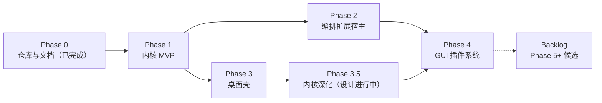

# 路线图：总览

- 状态：定稿
- 日期：2026-10-26
- 关联：ADR-0001~0013；README 进度看板（阶段状态以 README 为准）

## 1. 阶段总览与看板（本表是**唯一进度看板**）

> 自 0.1.2 起，README 不再重复看板；阶段状态只在本表维护。状态变更必须同步 CHANGELOG 与 `.agents/CONTEXT.md`。**最近更新：2026-10-27。**

| 阶段 | 一句话目标 | 参考估时* | 状态 |
|---|---|---|---|
| Phase 0 | 仓库初始化、规范与设计定稿、文档先行落盘 | — | ✅ 完成（2026-10-26） |
| Phase 1 | 无界面的最小可用内核：2 种协议 + 循环 + 工具 + 会话 + MCP | 6~10 周 | ✅ 完成（2026-10-26，tag `phase-1.end`） |
| Phase 2 | pi 编排类扩展可装载生效（A 轨） | 3~6 周 | ✅ 完成（2026-10-26，tag `phase-2.end`；报告 `docs/design/phase-2/report.md`） |
| Phase 3 | gpui-kit 桌面壳日常可用 + NSH 嵌入 PoC | 4~8 周 | ✅ 完成（2026-10-27，tag `phase-3.end`；报告 `docs/design/phase-3/report.md`） |
| [Phase 3.5](phase-3.5-kernel-depth.md) | 内核深化：补齐 pi 灵魂件（项目上下文/提示词工程/skills/compaction/缓存/无头模式），交互逻辑对齐 | 3~6 周 | 🔄 P0+P1 完成（D1/D2/D3/D4/D5/D7 通过）；**D6 subagent 标尺完成**（详设 08 + 四批落地，2026-10-27）；**P2 进行中：prompt 模板（09）与 provider composer/虚拟模型（10，批 A~B3）已落地；codemode 详设 11 定稿**，余 codemode 实现与信任门控（报告 `docs/design/phase-3.5/report.md`） |
| Phase 4 | GUI 原生插件系统闭环（B 轨） | 4~8 周 | 未开始 |

\* 单人全职参考值，仅量级感知。Phase 2 与 Phase 3 可并行。

> **桌面壳视觉精修（产品级 UI）**：**Phase 3.5 与 Phase 4 均收口后启动**（所有者定于 2026-10-27：届时内核功能面与插件槽位定型，皮一次做准；此前仅积累素材不启动）。素材与调查：[research/07](../research/07-ui-references.md)（参考清单，持续增补）+ [research/08](../research/08-zcode-desktop-study.md)（ZCode 交互逻辑源码调查，分批执行）→ 视觉设计稿（gpui-kit-design-guides 合规）→ 桌面壳实现批次。

## 2. 每阶段通用流程（硬流程，详见 standards/07）

1. **文档定稿**：本阶段 phase 文档及其引用设计稿从草稿转定稿（所有者知情即可，重大技术变更须 ADR）。
2. **实现**：feature 分支开发；规范全程生效。
3. **验收**：逐条执行本阶段"验收场景"，结果写入《阶段进度报告》。
4. **收尾**：进度报告 + 更新 README 看板 + CHANGELOG + ADR/架构文档回填 + 打 tag（`phase-N.end`）。

## 3. Backlog（Phase 5+ 候选，立项须先写 ADR）

> 本节同时是**创新提案的唯一通道**（ADR-0011）：内核复刻期（Phase 1~2）一切"更好的做法"只记录于此、不实施；解禁条件见 ADR-0011 §6。
> 2026-10-27 升格（ADR-0013）：compaction、codemode、print/json/headless 模式已从本清单升格至 [Phase 3.5](phase-3.5-kernel-depth.md)。

- 更多协议适配：openai-responses、google-generative-ai、bedrock（SigV4）
- 供应商 OAuth 与自定义 provider 完整面（`streamSimple` 等价物）
- 跨会话记忆系统（pi 无内置记忆，属创新提案：知识持久化优先走 AGENTS.md/skills，记忆按扩展/内核级另议）
- 审批档位与权限模式（pi 内核零审批、策略靠扩展：security.md 明言"不在每次工具调用前请求批准"，安全边界靠容器/账户隔离；本项目桌面端保留审阅安全垫，但需补档位——单次/会话/永久允许 + 模式三档"每次询问/自动审批/完全访问"（完全访问即现接缝 `tool_review=None`，pi 等价）；待 Phase 3 完工后由桌面壳批次或 Phase 3.5 承接，审批策略蓝本：pi 示例 permission-gate/confirm-destructive/protected-paths；**所有者已给四档模式设计（2026-10-27，research/07 §8.3b + assets/direction-mode-menu.png）：计划模式/变更前确认（默认）/自动编辑/完全访问**——其中三档为既有 K2 接缝的壳层策略，计划模式属创新档（pi 明确不做）待 ADR-0011 解禁）
- 会话树/分叉/navigate 的用户功能面（GUI 轨）
- tool-search（deferred 工具按需加载）
- A 轨 v2 成员逐个转正；B 轨 slot 扩展
- pi 会话导入工具；插件 marketplace；遥测（opt-in）
- ADR-0008 所列外围能力（chord/durable/env）——默认不做

## 4. 风险登记簿（跨阶段）

| 风险 | 等级 | 对策 |
|---|---|---|
| NSH 年轻（v0.2、公开 12 天）API 漂移 | 高 | 版本锁定；NSH 依赖隔离在 Phase 3/4 层，内核零依赖；升级窗口化 |
| 协议适配正确性（无上游 SDK 背书） | 高 | fixture 录制回放测试；以 pi 协议层行为为对照 |
| 估时偏差（AI 辅助开发节奏难预估） | 中 | 以验收场景为准不赶工期；阶段可并行降低阻塞 |
| QuickJS 兼容面不及预期（某扩展打包失败） | 中 | 诊断透明化；个案评估 deno_core 升级路径（ADR-0006 备选） |
| 单点开发（无第二双眼睛） | 中 | 规范+CI 硬门槛；每阶段进度报告披露风险 |
